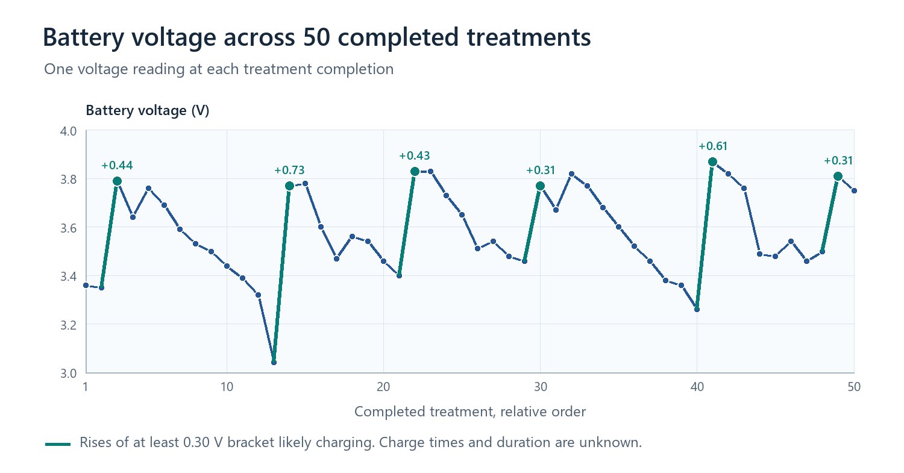
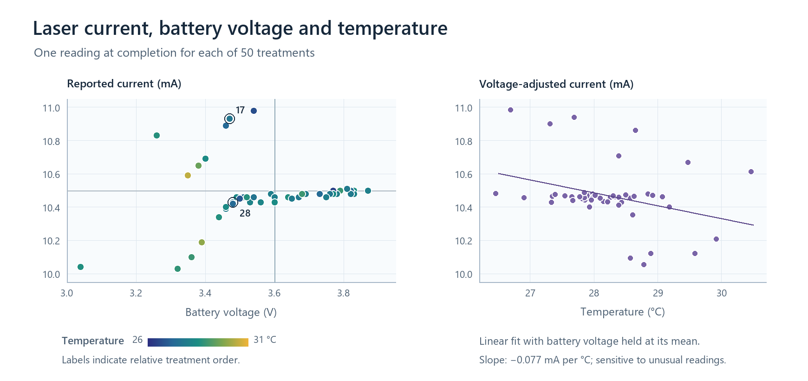

# LH40 treatment log and electrical readings

This analysis uses all 50 consecutive completed-treatment records retained by one EVO LH40. The figures and tables number the records from 1 to 50 in capture order. The original capture, including its calendar dates and clock times, remains local. [USB readout summary](verification.md#live-evo-lh40-tests)

## Log format and timestamps

The diagnostics screen shows these fields in this order. The single row below contains placeholders for every value.

```text
#          Date         DOW    Time       Battery   Temp(C)   Laser Current(mA)
<NUMBER>   MM/DD/YYYY   <DOW>  HH:MM:SS   <V.VV>    <TT.TT>   <II.II>
```

The archived application reads the real-time clock when writing the completed-treatment record, then increments the completed-treatment counter. The timestamp therefore represents the finish on the helmet clock. A prior pause can make the elapsed time from start longer than the active treatment time. A paused treatment that later finishes contributes one row at completion. The row has no fields for start time, duration, or pause history. An abandoned or timed-out treatment ordinarily contributes no dated row. Diagnostic counters 7 and 8 cover multiple stop and timeout paths, so their totals cannot identify how many treatments were abandoned. Theradome describes a five-minute window for resuming a paused treatment. [Record writer](../model/rebuild.asm#L13014) · [Treatment state model](../model/README.md#session-states) · [EEPROM record layout](../model/eeprom.md) · [Theradome pause guide](https://theradome.com/a/docs/guide/pause-treatment)

## Battery voltage and likely charges

The display omits the battery unit. The readings spanned 3.04–3.87 V, with a median of 3.54 V, when interpreted as pack voltage. The archived application copies the measured battery value into the log and compares the same measured value with about 4.20 V for the charging indicator. Theradome specifies a protected lithium-ion pack with a 3.7 V nominal voltage and a 4.2 V recharge voltage. These observations support interpreting the field as single-cell pack voltage. The board's sense point relative to the pack's protection circuit remains unverified. [Charging waveform](../model/indicator.md) · [Treatment record layout](../model/eeprom.md) · [Theradome battery specifications](https://theradome.com/products/replacement-battery)



Six successive readings rose by at least 0.31 V. The next-largest rise was 0.15 V. The separation supports interpreting the six large rises as likely substantial charges. Each row brackets a possible charge between consecutive treatment finishes.

| Relative treatments | Before | After | Rise | Treatments since previous large rise |
| --- | ---: | ---: | ---: | ---: |
| 2 → 3 | 3.35 V | 3.79 V | 0.44 V | Earlier charge outside the capture |
| 13 → 14 | 3.04 V | 3.77 V | 0.73 V | 11 |
| 21 → 22 | 3.40 V | 3.83 V | 0.43 V | 8 |
| 29 → 30 | 3.46 V | 3.77 V | 0.31 V | 8 |
| 40 → 41 | 3.26 V | 3.87 V | 0.61 V | 11 |
| 48 → 49 | 3.50 V | 3.81 V | 0.31 V | 8 |

Possible top-ups precede relative treatments 5 (+0.12 V), 18 (+0.09 V), and 32 (+0.15 V). The rises before 5 and 32 each split an 11-treatment interval into two treatments before the possible top-up and nine afterward. Voltage declined at each successive finish in both nine-treatment stretches. Eight treatments was the most common interval between large rises. About eight to nine treatments is a reasonable description of the observed pattern. The log records one voltage per finish, so the actual plug-in times, charge duration, and starting state of charge remain unknown.

## Laser-current variation



All 22 readings at or above 3.60 V fell in the **10.43–10.51 mA** range. The other 28 readings had a 10.45 mA median and ranged from **10.03 to 10.98 mA**. The main pattern is wider variation at lower voltage, both above and below the usual level. The 3.60 V split is a descriptive choice for this capture. No firmware threshold at that voltage was established.

Temperatures ranged from 26.46 to 30.46 °C. A linear fit with voltage alone explained 4.5% of the current variation. Adding temperature raised that to 13.4%. Holding voltage fixed, the ordinary fit estimated −0.077 mA per °C. A Huber fit that downweighted unusual observations estimated −0.017 mA per °C. That sensitivity makes a temperature effect tentative. Relative treatments 17 and 28 had nearly equal voltages (3.47 and 3.48 V) and temperatures (27.69 and 27.67 °C), yet their currents differed by 0.50 mA (10.93 and 10.43 mA). These values describe variation between finish readings. The capture provides no continuous current trace or optical-power measurement.

## What the current reading represents

The archived application averages 20 ADC conversions on `AN8`. With the emitters enabled, it applies a signed factory correction and divides by 66 counts per mA. The correction read from this helmet was −25 counts. The writer truncates each reading to two displayed decimals. For example, 692 corrected counts correspond to 10.4848… mA and display as 10.48 mA. The ADC uses an internal 2.048 V reference in this path, so falling pack voltage does not directly lower the measurement reference. The distinction between actual current variation and variation introduced by the analog measurement chain remains unresolved. [Current conversion](../model/rebuild.asm#L13221) · [ADC reference selection](../model/rebuild.asm#L17113) · [Microchip ADC register definitions](https://ww1.microchip.com/downloads/en/DeviceDoc/PIC18F87K22-Family-Data-Sheet-30009960F.pdf#page=344)

The treatment code targets 10.50 mA on that one feedback channel. It accepts roughly 9.95–11.05 mA. When the reading is outside the band, it can adjust a five-bit analog reference one step in the correcting direction and sample again. All 50 logged values are inside the band. The highest, 10.98 mA, still falls within the tolerance. The 0.50 mA difference between the examples corresponds to about 33 corrected ADC counts, more than the displayed rounding can explain. The treatment path uses a fixed current target in the traced code. [Treatment target](../model/rebuild.asm#L11888) · [Feedback comparison and correction](../model/rebuild.asm#L13299)

The trace establishes a single feedback channel. A branch current or a value scaled to per-emitter current fits that evidence. The trace does not identify the physical connection to `AN8`. As a cross-check, Theradome's patent describes 231 J delivered over 20 minutes for its 40-emitter design, about 193 mW of average delivered optical power. A 3.7 V battery supplying 10.48 mA would provide about 39 mW of electrical input before losses, insufficient for the patent's figure. That comparison applies to the design described in the patent and supports treating 10.48 mA as something other than total pack current. The actual mapping from the feedback channel to the array remains open. [Theradome patent, Figure 9 and Table I](https://patents.google.com/patent/US10112058B2/en#description)
